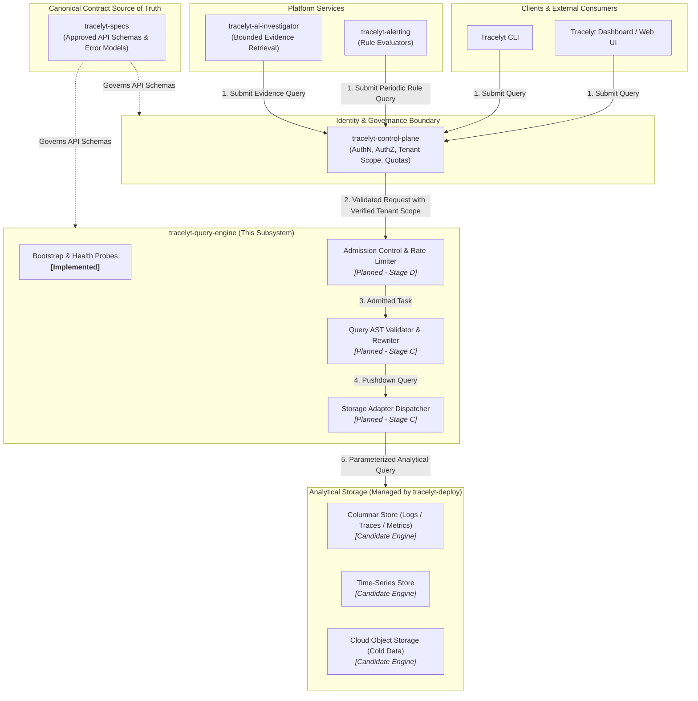

<p align="center">
  
</p>

<h1 align="center">Tracelyt Query Engine</h1>

<p align="center">
  <strong>Analytical Query Orchestration Subsystem for the Tracelyt Observability Platform</strong>
</p>

<p align="center">
  <a href="https://github.com/Tracelyt-Systems/tracelyt-query-engine/actions/workflows/ci.yml">
    
  </a>
  <a href="LICENSE">
    
  </a>
  <a href=".java-version">
    
  </a>
  <a href="https://spring.io/projects/spring-boot">
    
  </a>
</p>

---

## 1. Project Identity & Purpose

**Tracelyt Query Engine** (`tracelyt-query-engine`) is the analytical query subsystem of the **Tracelyt** open-source observability platform. Its future responsibility is to provide a consistent, secure, multi-tenant, and resource-bounded path for dashboards, alerting evaluators, and automated investigators to query metrics, logs, and distributed traces from backend storage systems.

> ### ⚠️ Project Status: Foundation & Architecture Setup
>
> **This repository is currently in its initial architectural setup phase (Stage A).**
>
> - **Current Capabilities:** Reproducible Java 21 LTS + Spring Boot 3.4.3 application bootstrap, verified build automation, Checkstyle 10.21.4 rules, security threat modeling, storage strategy evaluations, and CI workflows.
> - **Intentionally Not Implemented Yet:** No actual query execution (PromQL, SQL, LogQL), no database connections (ClickHouse, TSDB, PostgreSQL), no Redis caching, no Kafka streaming, no distributed query workers, and no mock endpoints returning fake telemetry.
> - **Contract Governance:** All external API schemas, pagination conventions, and error representations are governed by [`tracelyt-specs`](https://github.com/Tracelyt-Systems/tracelyt-specs).

---

## 2. Architecture Context Diagram

The following Mermaid diagram illustrates the conceptual future relationships between the Query Engine and the wider Tracelyt platform ecosystem.



---

## 3. Getting Started

### Prerequisites
- **Java Development Kit (JDK):** Version 21 LTS (Oracle OpenJDK, Eclipse Temurin, or Microsoft Build of OpenJDK). Verify via `java -version`.
- **Git:** Version 2.30+.
- **Python:** Version 3.9+ (used for local documentation and linting validation).
- **Make:** Version 3.81+ (Optional developer convenience).

### Building & Validating Locally

The project includes the Apache Maven Wrapper for reproducible builds without requiring a pre-installed Maven binary.

```bash
# Clone the repository
git clone https://github.com/Tracelyt-Systems/tracelyt-query-engine.git
cd tracelyt-query-engine

# Validate formatting, Checkstyle, and run context smoke tests
# Linux / macOS:
./mvnw -B -ntp clean test checkstyle:check

# Windows (Command Prompt or PowerShell):
mvnw.cmd -B -ntp clean test checkstyle:check
```

### Running the Application Bootstrap

```bash
# Start the lightweight Spring Boot application (port 8083)
./mvnw spring-boot:run

# Verify actuator health probe in another terminal:
curl http://localhost:8083/actuator/health
# {"status":"UP"}
```

*Note: The bootstrap application verifies configuration loading and binds health endpoints. It does not accept query requests or connect to backend storage.*

---

## 4. Documentation Guide

The repository includes detailed architecture, security, and operational documentation:

| Category | Key Documents |
|---|---|
| **Architecture** | • [Architecture Overview](docs/architecture/overview.md)<br>• [System Boundaries](docs/architecture/system-boundaries.md)<br>• [Technology Strategy](docs/architecture/technology-strategy.md)<br>• [Storage Strategy](docs/architecture/storage-strategy.md)<br>• [Multi-Language Boundaries](docs/architecture/language-boundaries.md)<br>• [Query Lifecycle](docs/architecture/query-lifecycle.md)<br>• [Scalability & High Cardinality](docs/architecture/scalability.md)<br>• [Failure Model](docs/architecture/failure-model.md)<br>• [Deployment Models](docs/architecture/deployment-models.md) |
| **Decisions (ADRs)** | • [ADR Index](docs/decisions/README.md)<br>• [ADR-0001: Adopt Java 21 LTS + Spring Boot 3.4](docs/decisions/0001-adopt-java21-spring-boot-foundation.md) |
| **Security & Privacy** | • [Threat Model](docs/security/threat-model.md)<br>• [Secure Development Lifecycle](docs/security/secure-development.md)<br>• [Data Privacy & Minimization](docs/security/data-privacy.md)<br>• [Supply Chain Hardening](docs/security/supply-chain.md) |
| **Operations** | • [Configuration Policy](docs/operations/configuration.md)<br>• [Subsystem Observability](docs/operations/observability.md)<br>• [Resource Limits & Quotas](docs/operations/resource-limits.md)<br>• [Capacity Planning](docs/operations/capacity-planning.md)<br>• [Disaster Recovery](docs/operations/disaster-recovery.md)<br>• [Deployment Readiness](docs/operations/deployment-readiness.md) |
| **Standards & Roadmap** | • [Contract Governance](docs/standards/contract-governance.md)<br>• [Compatibility Policy](docs/standards/compatibility.md)<br>• [Error Handling Standards](docs/standards/error-handling.md)<br>• [Performance Testing Standards](docs/standards/performance-testing.md)<br>• [Architecture Evolution Roadmap](docs/roadmap/architecture-evolution.md) |

---

## 5. Security & Vulnerability Reporting

Security is a primary design goal. Please review:
- [`SECURITY.md`](SECURITY.md) for vulnerability disclosure procedures.
- [`docs/security/threat-model.md`](docs/security/threat-model.md) for STRIDE threat analysis and tenant isolation boundaries.

**Please do not report security vulnerabilities through public GitHub issues.**

---

## 6. Contributing & Community

We welcome contributions! Please review our:
- [`CONTRIBUTING.md`](CONTRIBUTING.md) for development workflows and PR requirements.
- [`CODE_OF_CONDUCT.md`](CODE_OF_CONDUCT.md) for community standards.
- [`GOVERNANCE.md`](GOVERNANCE.md) for decision-making processes.
- [`MAINTAINERS.md`](MAINTAINERS.md) for current maintainer listings.
- [`SUPPORT.md`](SUPPORT.md) for getting help.

---

## 7. License

This project is licensed under the **Apache License, Version 2.0**. See [`LICENSE`](LICENSE) and [`NOTICE`](NOTICE) for details.
