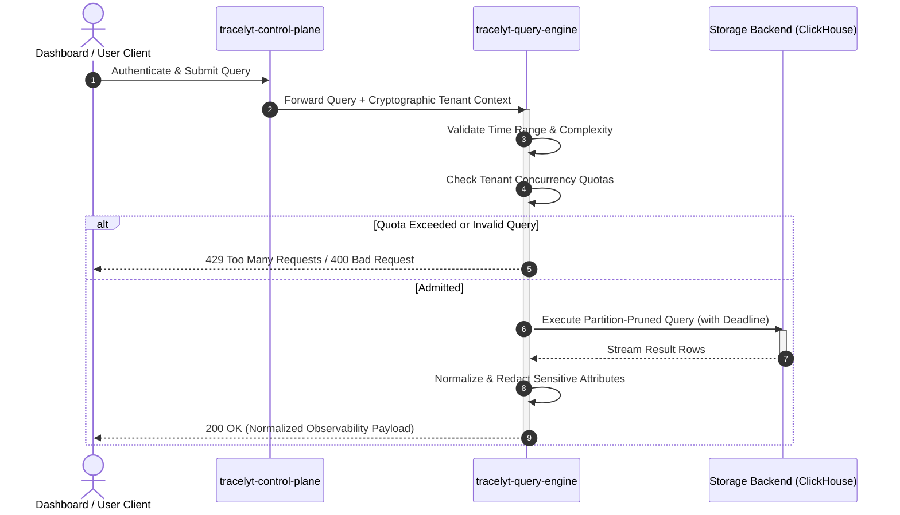

# Architecture Diagrams

This directory provides architectural diagrams modeling the planned system context, query flow, and trust boundaries for `tracelyt-query-engine`.

---

## 1. Sequence Diagram: Planned Query Execution



---

## 2. Trust Boundary Diagram

```mermaid
flowchart TD
    subgraph UntrustedZone["Untrusted Network"]
        USER["Browser Client / External API"]
    end

    subgraph EdgeBoundary["Edge Security Boundary"]
        GATEWAY["tracelyt-control-plane\n(TLS Termination · JWT Validation)"]
    end

    subgraph InternalPlatform["Internal Platform Network (Authenticated)"]
        QE["tracelyt-query-engine\n(Tenant Admission · Query Planner)"]
        STORE[("Columnar Database\n(ClickHouse / TSDB)")]
    end

    USER -->|HTTPS Query Request| GATEWAY
    GATEWAY -->|Validated Internal Context| QE
    QE -->|Internal Query (Deadline Bounded)| STORE
```

*Note: These diagrams illustrate planned system architecture; runtime services and database nodes are not yet deployed.*
