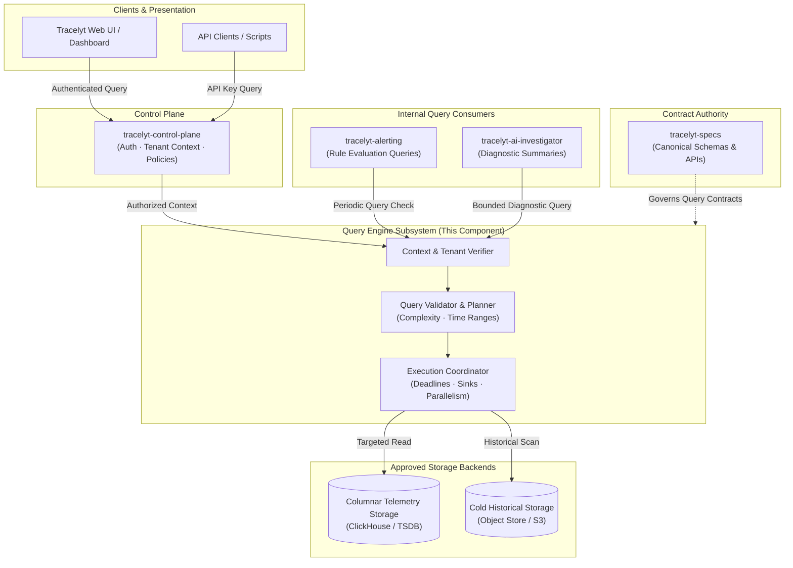

# Architecture Overview

This document details the architectural role, high-level topology, and design principles of the **Tracelyt Query Engine**.

> [!IMPORTANT]
> **Stage: Initial Architecture & Foundation Scaffolding (Pre-1.0)**  
> This document details the planned architectural topology and future query orchestration responsibilities.  
> **No query execution engines, storage connections, or production endpoints are currently implemented.**

---

## 1. Why a Dedicated Query Engine?

In modern cloud observability architectures, ingesting telemetry and querying it represent fundamentally asymmetrical workloads:

1. **Write Path vs. Read Path Separation**:
   - The write path (handled by `tracelyt-ingestion` and `tracelyt-telemetry-pipeline`) is continuous, write-heavy, and focused on rapid ingestion, validation, and micro-batch database insertion.
   - The read path (owned by `tracelyt-query-engine`) is bursty, read-heavy, latency-sensitive, and involves complex analytical aggregations, time-bucket downsampling, and cross-signal trace-to-log correlation.
2. **Multi-Domain Query Complexity**:
   - Observability queries span distinct domains: time-series metrics (rate, histogram percentiles), structured log filters (regex, keyword searches), and distributed trace waterfalls (span DAGs, latency bottlenecks).
   - A dedicated query engine coordinates queries across these heterogeneous domains without overloading ingestion proxies.
3. **Resource Protection & Multi-Tenant Isolation**:
   - Unbounded analytical queries (e.g., aggregations over high-cardinality attributes across multi-month windows) can easily exhaust database memory and CPU.
   - The query engine serves as an admission controller, enforcing query deadlines, memory budgets, row caps, and per-tenant query concurrency limits.

---

## 2. High-Level System Context

The following diagram illustrates how the query engine integrates into the wider Tracelyt platform architecture:

*Note: This diagram illustrates planned system architecture; services and storage connections are not yet deployed.*

---

## 3. Query Domains Supported (Planned)

The query engine is designed to support three distinct observability telemetry domains:

1. **Metrics Queries**:
   - Evaluation of time-series counters, gauges, and histograms.
   - Rate calculations, moving averages, and percentile rollups across specified time windows and step intervals.
2. **Log Queries**:
   - Structured search across log attributes, severity levels, and text matching.
   - Aggregations by service, host, and error fingerprint.
3. **Trace Queries**:
   - Trace retrieval by trace ID, span status (error vs. success), duration thresholds, and service operations.
   - Reconstruction of distributed trace Directed Acyclic Graphs (DAGs) and span waterfall visualization.
4. **Cross-Signal Correlation**:
   - Using trace context (`trace_id`, `span_id`) to correlate distributed trace anomalies directly with contemporaneous logs and metric spikes.

---

## 4. Key Architectural Principles

- **Storage-Agnostic Abstraction**: Query planning and request contracts are decoupled from physical database drivers via clean adapter boundaries.
- **Fail-Safe Resource Budgets**: Every query executes with hard timeouts and memory bounds. Queries that exceed limits are terminated cleanly with actionable errors.
- **Contract-First Governance**: Interface schemas, error models, and pagination standards are governed centrally in `tracelyt-specs`.
