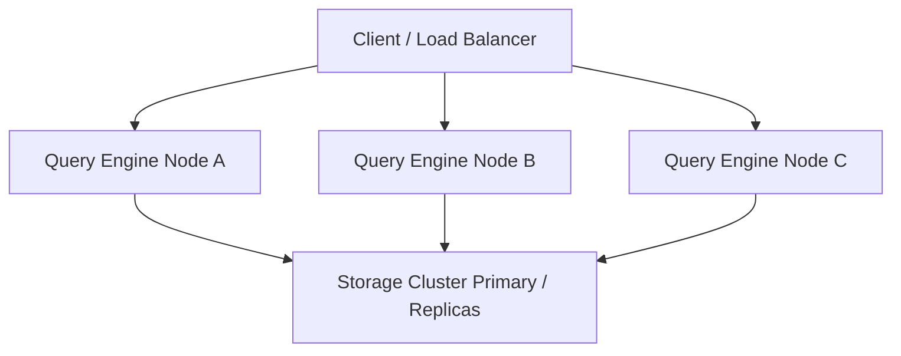

# Disaster Recovery & High Availability

This document outlines the high-availability topology, failure recovery procedures, storage partition mitigation, and operational continuity strategies for `tracelyt-query-engine`.

---

## 1. High Availability Architecture

The query engine coordinator is designed to be **stateless**:
- **Stateless Coordinator Nodes:** Individual query engine instances maintain no persistent local disk state. All routing state, admission permits, and query execution threads reside purely in memory.
- **Horizontal Replicas:** Multiple coordinator instances can run behind a standard Layer 4/7 load balancer (e.g., NGINX, AWS ALB, Kubernetes Service).
- **Zero-Downtime Rolling Restarts:** Because instances are stateless, Kubernetes rolling deployments can terminate and replace nodes without data loss.

---

## 2. Failure Scenarios & Recovery Procedures

### 2.1 Complete Query Engine Node Crash
- **Symptoms:** Instance stops responding to health checks (`/actuator/health`).
- **Automated Recovery:** Load balancer detects failed health checks within 5–10 seconds and stops routing traffic. Kubernetes controller automatically spawns a replacement pod.
- **Client Impact:** Active in-flight queries executing on the crashed node fail with connection reset or timeout. Clients or UI dashboards retry once with exponential backoff.

### 2.2 Analytical Storage Outage (e.g., ClickHouse Unavailable)
- **Symptoms:** High rate of storage connection timeouts; downstream connection pools exhausted.
- **Mitigation:**
  - Circuit breakers trip to prevent thread starvation on the query coordinators.
  - Subsystem returns structured RFC 9457 error (`503 Service Unavailable` with `Retry-After` header).
  - Actuator readiness probe marks instance unready if storage is unreachable for extended periods.

### 2.3 Storage Cluster Network Partition (Split-Brain)
- **Symptoms:** Storage nodes report disparate partition availability or replica lag.
- **Mitigation:** The query coordinator must route read queries only to storage replicas with verified replica lag below configured thresholds (e.g., lag < 10 seconds). If all replicas are stale, return explicit partial-data or lag warnings in the response envelope.

---

## 3. Data Durability & Backup Responsibilities

The query engine **does not store telemetry persistently**. Persistent data durability, incremental backups, snapshotting, and point-in-time recovery (PITR) are the sole responsibility of the underlying analytical storage infrastructure and deployment configurations (managed via `tracelyt-deploy`).
