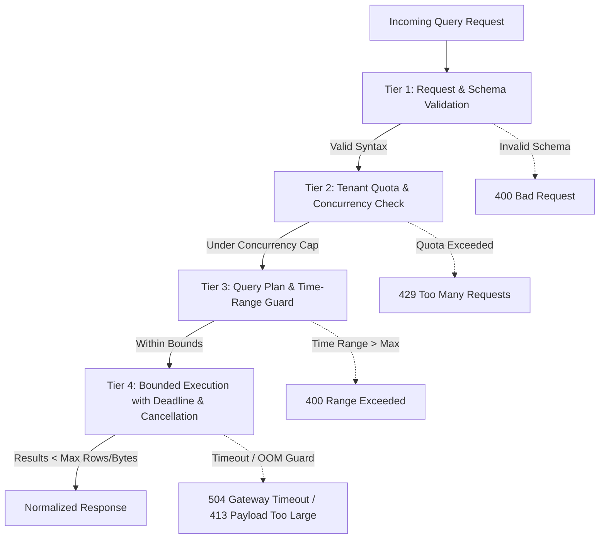

# Resource Limits, Quotas & Execution Safeguards

This document defines the admission control policies, execution budgets, deadline enforcement mechanisms, and tenant quota safeguards for `tracelyt-query-engine`.

> **Status Notice:** This document establishes design specifications for query safety. No runtime rate limiters or query execution budgets are implemented in this repository foundation.

---

## 1. The Need for Execution Safeguards

Analytical queries in observability systems scan billions of time-series data points, log lines, and trace spans. Without strict limits, a single poorly constructed query (e.g., regex wildcard scan over 90 days) can:
- Exhaust JVM heap memory leading to Out-Of-Memory (OOM) crashes.
- Starve worker threads, blocking dashboard and alerting queries for other tenants.
- Overload shared storage nodes (ClickHouse, TSDB), causing cluster-wide latency spikes.

---

## 2. Multi-Tiered Safeguard Model

---

## 3. Limit Specifications

| Safeguard | Target Threshold | Action Upon Violation | Rationale |
|---|---|---|---|
| **Maximum Query Time Range** | Default: 7 days Max allowed: 30 days | Reject immediately with descriptive error | Prevents accidental table scans across years of historical cold storage. |
| **Execution Timeout (Deadline)** | Interactive: 15s Background/Alerting: 60s | Cancel storage query socket; return `504` | Frees coordinator thread and worker resources from stuck queries. |
| **Maximum Scanned Bytes** | 10 GB per single query | Terminate execution mid-scan | Protects backend storage cluster from runaway disk I/O saturation. |
| **Maximum Result Rows** | 100,000 rows | Truncate results with `has_more: true` flag | Protects coordinator JVM heap from memory exhaustion during serialization. |
| **Maximum Result Payload Size** | 50 MB | Abort serialization; return `413 Payload Too Large` | Prevents network buffer saturation and browser client crashes. |
| **Tenant Concurrency Cap** | 10 concurrent queries per tenant | Enqueue in bounded admission queue (max 50) or reject with `429` | Ensures fairness across multi-tenant environments; prevents noisy-neighbor DoS. |

---

## 4. Client Cancellation Propagation

When a client closes an HTTP connection (e.g., user navigates away from a dashboard tab), the query engine must:
1. Detect connection closure via the HTTP server listener.
2. Cancel the query's `CompletableFuture` / structured concurrency scope.
3. Propagate a cancellation signal to the active storage socket (e.g., sending `KILL QUERY` to ClickHouse).
4. Immediately release allocated thread slots and admission permits.
