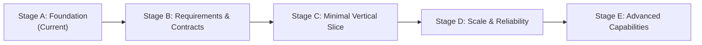

# Architecture Evolution: Future Stages

This document outlines the planned evolutionary stages for transitioning `tracelyt-query-engine` from an architectural foundation into a production-grade observability query subsystem.

> **Roadmap Disclaimer:** This represents a conceptual engineering roadmap, not a commitment to delivery dates or fixed features. Each stage requires explicit maintainer review, ADR approval, and benchmark validation before work begins.

---

## Evolution Stages Overview

---

## Stage A — Foundation (Current Baseline)
- **Status:** Complete.
- **Objectives:**
  - Establish repository foundation, directory structure, build automation, and code formatting tooling.
  - Implement minimal Java 21 LTS + Spring Boot 3.4.3 application bootstrap with verified smoke tests.
  - Define architectural boundaries, security threat model, storage strategy, and multi-language adoption policies.
  - Establish contract governance pointing to `tracelyt-specs` as canonical authority.
- **Implementation Boundary:** Zero query execution, zero storage drivers, zero mock endpoints.

---

## Stage B — Requirements & Shared Contracts
- **Status:** Planned (Next Milestone).
- **Prerequisites:** Maintainer consensus on initial target query use cases.
- **Objectives:**
  - Define concrete query use cases (e.g., metrics time-series retrieval for dashboards).
  - Review and approve query request/response schemas in `tracelyt-specs`.
  - Finalize authentication context propagation contracts with `tracelyt-control-plane`.
  - Establish RFC 9457 error representation schemas and tenant quota parameters.
- **Implementation Boundary:** Contract definitions and schema models only.

---

## Stage C — Minimal Vertical Slice
- **Status:** Future.
- **Prerequisites:** Stage B contracts approved; explicit maintainer implementation approval.
- **Objectives:**
  - Implement one narrowly scoped query path (e.g., basic Prometheus-compatible instant/range metric query).
  - Integrate exactly one justified analytical data source (e.g., ClickHouse time-series table).
  - Implement AST validation, mandatory tenant filtering, query timeout enforcement, and sanitized error mapping.
  - Validate with automated end-to-end integration tests using ephemeral test containers.
  - Measure real execution behavior and memory footprint before introducing any further complexity.

---

## Stage D — Scale & Reliability
- **Status:** Future.
- **Prerequisites:** Stage C vertical slice verified with empirical performance metrics.
- **Objectives:**
  - Introduce query admission control with fair-share tenant queuing.
  - Evaluate result caching (e.g., immutable historical tile caching) if cache hit profiles justify it.
  - Implement query cancellation propagation across storage connection pools.
  - Benchmark against high-cardinality telemetry datasets under sustained concurrency.
  - Evaluate distributed worker execution (coordinator-worker topology) if coordinator nodes become CPU-bound.

---

## Stage E — Advanced Capabilities
- **Status:** Long-Term Vision.
- **Prerequisites:** Proven production stability across Stages C & D.
- **Objectives:**
  - Multi-signal correlation queries (e.g., correlating metric spike with corresponding log error patterns).
  - Specialized high-concurrency worker nodes (e.g., Go-based query executors if justified by ADR).
  - Integration with `tracelyt-ai-investigator` providing authorized, bounded query evidence summaries.
  - Native SIMD vectorized filtering (Rust/C++) only if profiling demonstrates measurable CPU bottlenecks unreachable via Java 21 vector APIs.
