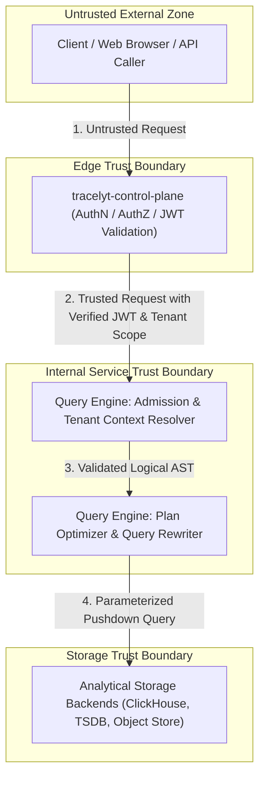

# Threat Model: Tracelyt Query Engine

This document provides a structured threat analysis for the future query engine subsystem within the Tracelyt Observability Platform.

> **Status Notice:** This document identifies architectural threats and planned mitigations. In the current foundational phase, no query execution or storage adapters exist. Documented mitigations represent design requirements for future implementation phases, not currently active runtime controls.

---

## 1. Assets & Trust Boundaries

### 1.1 Protected Assets
1. **Telemetry Data:** Sensitive application logs, metrics, traces, and environment metadata stored in analytical backends.
2. **Tenant & Project Metadata:** Organization IDs, project keys, access control tokens, and quota definitions.
3. **Execution Resources:** CPU cores, heap memory, thread pools, and network bandwidth of query engine nodes.
4. **Platform Infrastructure Credentials:** Storage access keys, internal service mTLS certificates, and identity provider secrets.

### 1.2 Trust Boundaries

---

## 2. Threat Analysis Matrix

| ID | Threat Category | Threat Scenario | Impact | Proposed Mitigation (Future Implementation) | Residual Risk | Responsible Service |
|---|---|---|---|---|---|---|
| **TM-01** | Cross-Tenant Data Leakage | Attacker submits query with forged `tenant_id` or manipulates query predicates to bypass project filters. | Critical: Unauthorized access to another tenant's logs, traces, or metrics. | Tenant context must come solely from cryptographically verified claims injected by `tracelyt-control-plane`. Query rewriter enforces mandatory tenant predicate pushdown. | Misconfiguration in query rewriter or token verification. | `tracelyt-control-plane` & `tracelyt-query-engine` |
| **TM-02** | Query Injection | Attacker injects malicious SQL/PromQL/AST fragments via unescaped search strings or regex filters. | High: Arbitrary storage execution, data exfiltration, or table dropping. | AST-based query generation; raw string concatenation prohibited; strict regex validation against ReDoS; parameterized storage drivers. | Zero-day parser vulnerabilities in upstream storage drivers. | `tracelyt-query-engine` |
| **TM-03** | Maliciously Expensive Queries (DoS) | Attacker executes unbounded Cartesian product or regex wildcard search across years of historical data. | High: Storage node saturation, memory exhaustion, service outage for other tenants. | Strict query time-range caps (e.g., max 7 days by default); mandatory limit clauses; pre-execution query cost estimation; query cancellation deadlines. | High-volume valid queries within limits may still degrade performance. | `tracelyt-query-engine` |
| **TM-04** | Out-of-Memory (OOM) via Massive Results | Query matches billions of rows, buffering entire result set into JVM heap memory. | High: Node crash, JVM OOM killer invocation, cascading query coordinator failover. | Streaming result consumption; hard byte and row limits (e.g., 50MB / 100,000 rows max); client-side pagination enforcement. | Memory leaks in streaming deserialization buffers. | `tracelyt-query-engine` |
| **TM-05** | Confused Deputy / Unauthorized Service Calls | Unauthenticated actor calls internal query engine port directly, bypassing control-plane auth. | High: Complete bypass of tenant authorization and rate limits. | Mandatory mTLS between internal Tracelyt services; network policies (Kubernetes NetworkPolicy) isolating query port. | Compromised internal node with valid service certificate. | `tracelyt-deploy` & `tracelyt-query-engine` |
| **TM-06** | Server-Side Request Forgery (SSRF) | Attacker configures external data source URL pointing to internal cloud metadata IP (169.254.169.254). | Critical: Cloud instance credential exfiltration, infrastructure takeover. | External data source definitions must be restricted to control-plane admin roles; strict IP blacklisting for loopback and link-local addresses. | DNS rebinding attacks if validation does not resolve IPs before connecting. | `tracelyt-control-plane` & `tracelyt-query-engine` |
| **TM-07** | Sensitive Data Leakage in Logs & Errors | Database connection strings, auth headers, or raw telemetry dumped into application logs or client error payloads. | Medium: Credential leakage, privacy compliance violation. | RFC 9457 sanitized error responses; Logback masking filters redacting tokens and headers; stack traces suppressed in production responses. | Unhandled exceptions bypassing standard error handlers. | `tracelyt-query-engine` |
| **TM-08** | Supply-Chain & Dependency Attacks | Malicious dependency version introduced via compromised upstream repository or typo-squatting. | Critical: Remote code execution (RCE) on query engine coordinator nodes. | Weekly Dependabot scanning; automated GitHub Dependency Review; immutable SHA pinning for GitHub Actions; minimal dependencies. | Undetected zero-day vulnerabilities in transitive libraries. | Platform Engineering & Security Team |
| **TM-09** | ReDoS (Regular Expression Denial of Service) | User submits pathologically nested regex (e.g., `(a+)+$`) evaluated against millions of log lines. | High: CPU core starvation, thread pool lockup. | Replace standard Java `java.util.regex` with linear-time regex engines (e.g., Google RE2/J); regex execution timeout caps. | Highly complex valid regexes may still take noticeable execution time. | `tracelyt-query-engine` |
| **TM-10** | Insecure Self-Hosted Defaults | Self-hosted instance deployed with empty passwords, open ports, or unrestricted admin query access. | High: Public internet exposure of sensitive observability telemetry. | Fail-safe startup validation rejecting insecure configurations in production; safe default limits; clear deployment documentation. | User intentionally disabling security validation flags. | `tracelyt-deploy` & `tracelyt-query-engine` |

---

## 3. Implementation Verification Checklist (Future Stages)

When query execution features are implemented in subsequent roadmap phases, each feature PR must verify:
- [ ] Tenant ID cannot be modified or overridden by client request parameters.
- [ ] Query rewriter injects tenant and project scope at the lowest AST branch.
- [ ] Storage adapters use parameterized bindings, never raw string interpolation.
- [ ] Time-range maximums and result size maximums are strictly enforced.
- [ ] Context cancellation and timeout signals propagate to storage sockets.
- [ ] Error messages return sanitized problem envelopes without internal stack traces.
